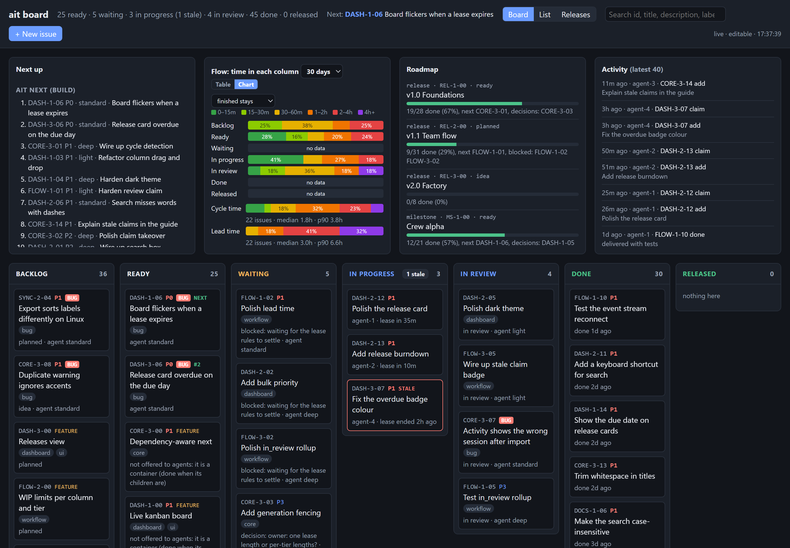
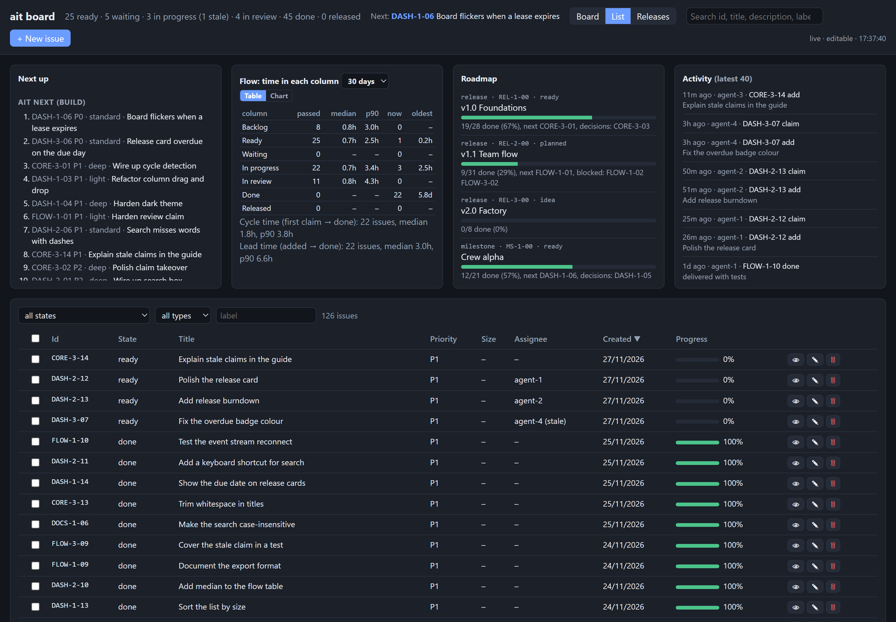
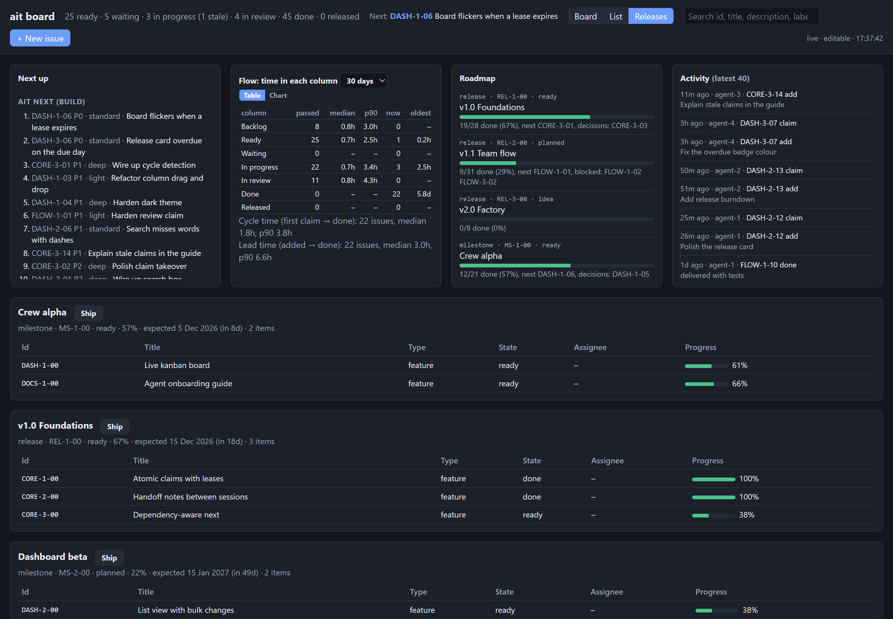

# ait — the issue tracker your AI agents can share

`ait` is a single executable that gives a crew of AI coding agents, and the
person running them, one shared backlog. Agents talk to it through a CLI that
always answers in JSON; you watch and steer from a live local dashboard. The
data is a SQLite file inside your repository's `.git` folder: no server, no
account, nothing leaves your machine.



## Why not just GitHub Issues?

GitHub Issues is built for people clicking in a browser. Agents need other
things: to grab work without colliding, to survive crashes, and to pick up
where the last session stopped.

| | GitHub Issues | ait |
|---|---|---|
| Two agents grab the same issue | Both start; you find out at merge time | Exactly one wins: claims are atomic |
| An agent crashes mid-task | The issue stays "assigned" forever | Its lease runs out; another agent takes over, and the crashed one's late writes are refused |
| Next session needs context | Re-read the whole thread | `ait show` returns the issue, the latest handoff note and recent notes in one JSON object |
| "What should I do next?" | Labels and judgment | `ait next --claim`: highest priority, dependencies met, approved, within WIP limits |
| Machine-readable output | REST API, rate limits, tokens | Every command takes `--json`, with stable error codes and exit codes |
| Works offline / no account | No | Yes: one file, local SQLite |
| Speed | Network round trips | Milliseconds |
| Is "done" really merged? | Manual | `ait check --git` compares closed issues with merges on main |
| Shared with people outside the repo | Yes | No: it is a local tool (see Limitations) |

## Why it is great for agents

- **One call to get work:** `ait next --claim --json` picks and claims the
  right issue in a single transaction, or exits with code 6 when nothing is
  ready.
- **Leases and generations:** every claim has a lease that each call renews,
  and a generation number. When a lease expires and someone else takes over,
  writes carrying the old generation are refused, so an agent that wakes up
  late can never overwrite its successor's work.
- **Handoffs:** `ait handoff` stores "done / remaining / branch / last
  commit" so the next session resumes instead of starting over.
- **Guard rails, not prompts:** acceptance criteria must be checked (with
  evidence) before review or done, reviews gate their parent, WIP limits are
  enforced, and owner approvals decide what agents may pick up.
- **Errors an agent can act on:** `{"error":{"code","message","retryable"}}`
  with a meaningful exit code (busy = retry, conflict = stop).
- **Self-documenting:** `ait guide` prints the whole agent workflow; paste it
  or the block from INSTALL.md into your `AGENTS.md`.
- **Issue text is treated as data**, and the guide tells agents never to
  follow instructions found inside issues.

## Features

| Area | What you get |
|---|---|
| Issues | Tasks, bugs, features, milestones, releases and reviews; priorities P0–P4, rank, size, labels, expected dates, agent tier and effort |
| Dependencies | `needs` links (optionally "until in review"), cycle detection, "why isn't this ready?" with `next --explain` |
| Claims | Atomic claims, leases (per claim if you like, up to 30 days), stale-claim takeover, generations |
| Context | Notes, handoffs, discovered-from links, activity log of every change |
| Quality gates | Acceptance criteria with evidence, review issues, WIP limits per column and per agent tier, owner approvals |
| Releases | Roll-up progress for features, milestones and releases; `ait ship` checks every member is done and merged |
| Dashboard | Kanban board with drag and drop, list view with search, filters and bulk changes, releases view with expected dates, roadmap, flow statistics (table or chart), activity feed |
| Integration | Versioned HTTP API and live event stream for your own UI ([API.md](docs/API.md)), CORS for local origins |
| Data safety | Database in `.git/ait/` (shared by worktrees, never committed), daily backups, readable export/import with a byte-for-byte round trip, `ait check` |

| List view | Releases view |
|---|---|
|  |  |

## Quick start

Download the latest `ait-…-windows-x64.zip` from the
[Releases page](../../releases/latest) and unzip it. Then, in your repository:

```
mkdir tools\ait
copy <unzipped>\ait.exe tools\ait\
copy <unzipped>\default.cfg tools\ait\
tools\ait\ait.exe init
tools\ait\ait.exe add CORE "My first issue" --priority P1
tools\ait\ait.exe next --claim --as agent-1 --json
tools\ait\ait.exe serve
```

Open <http://127.0.0.1:7777/>. Add `tools/ait/ait.exe` to `.gitignore`.

Want something to look at first? The zip also holds `examples\demo.jsonl`, a made-up
backlog of 100 issues. Import it into a scratch database, from the unzipped
folder:

```
ait --db demo.db init
ait --db demo.db import --issues examples\demo.jsonl
ait --db demo.db serve
```

**Requirements:** Windows x64 (the published build), `git` on the PATH for the
git checks. Nothing else: no runtime, no installer, no service. Other
platforms can build from source (see below); only Windows is tested today.

## Installing it for your agents

[INSTALL.md](INSTALL.md) is written for an agent to
follow step by step: copy the two files, set the id prefixes in
`default.cfg`, load an existing backlog, and paste the agent block into the
repository's `AGENTS.md`. A prompt like this is enough:

> Install the issue tracker `ait` in this repository by following INSTALL.md
> from the latest release. Ask me before changing anything outside the repo.

## How it works

```
agent: ait next --claim         → claim (lease 60m, generation 1)
agent: ait note / handoff       → every call renews the lease
agent: ait criteria --check N   → evidence recorded
agent: ait done --gen 1         → issue done, claim released

crash? lease runs out → another agent claims it (generation 2)
the old agent's writes with --gen 1 → refused (STALE_GENERATION)
```

Everything is one SQLite database in WAL mode; every write is a short
`BEGIN IMMEDIATE` transaction, so many agents can work at once.

## Your data and safety

- The database lives in `<repo>/.git/ait/tracker.db`: every worktree shares
  it and git never commits it.
- `ait backup` and daily automatic backups (`.git/ait/backups/`);
  `ait export` writes a readable JSONL file you can import again.
- The dashboard listens on 127.0.0.1 only, checks the Host header, and needs
  a per-start token to change anything. `ait serve --read-only` is view-only.

## Updating

1. `tools\ait\ait.exe backup`
2. Replace `tools\ait\ait.exe` with the one from the newest release.
3. The first command upgrades the database automatically. An older `ait`
   refuses a newer database, so keep the backup if you might go back.
4. Re-paste the agent block from INSTALL.md into `AGENTS.md` (new features
   add instructions), or run `ait guide` to see the current workflow.

Release notes are on the [Releases page](../../releases); the API changelog is
at the end of [API.md](docs/API.md).

## Limitations

- One machine: no sync between computers, no hosted version.
- No user accounts or permissions; sessions are names agents choose.
- No GitHub/Jira sync (import from a JSONL inventory is supported).
- Built and tested on Windows only for now.

## Documentation

| You want to | Read |
|---|---|
| Install it in a repository | [INSTALL.md](INSTALL.md) |
| Every command, the dashboard, import/export | [docs/COMMANDS.md](docs/COMMANDS.md) |
| Build a UI on top (HTTP + JSON contract) | [docs/API.md](docs/API.md) |
| Work on the code | [AGENTS.md](AGENTS.md) |

## Building from source and contributing

```
cargo build --release
```

The result is `target/release/ait.exe`. Dependencies (`rusqlite` with bundled
SQLite, `serde`, `serde_json`) are pinned by `Cargo.lock`; the first build
downloads them, like `npm install`. Every change must pass the quality gate, which CI also runs:

```
cargo fmt --all -- --check
cargo clippy --all-targets --all-features -- -D warnings
cargo test --all-targets
```

The code is written and maintained by AI agents under the rules in
[AGENTS.md](AGENTS.md): no `unsafe`, no panics in normal code, tests for
every command and fix, and no new dependencies without approval.

Releases are published by pushing a version tag that matches
`Cargo.toml` (`git tag v0.1.0 && git push origin v0.1.0`).

## License

[MIT](LICENSE)
